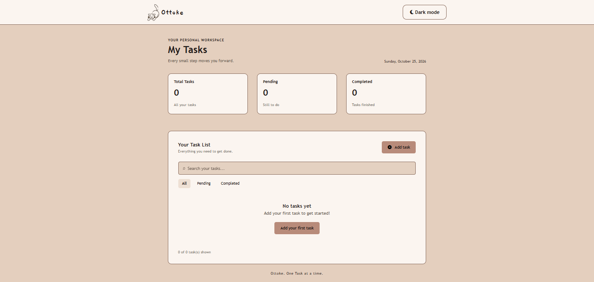
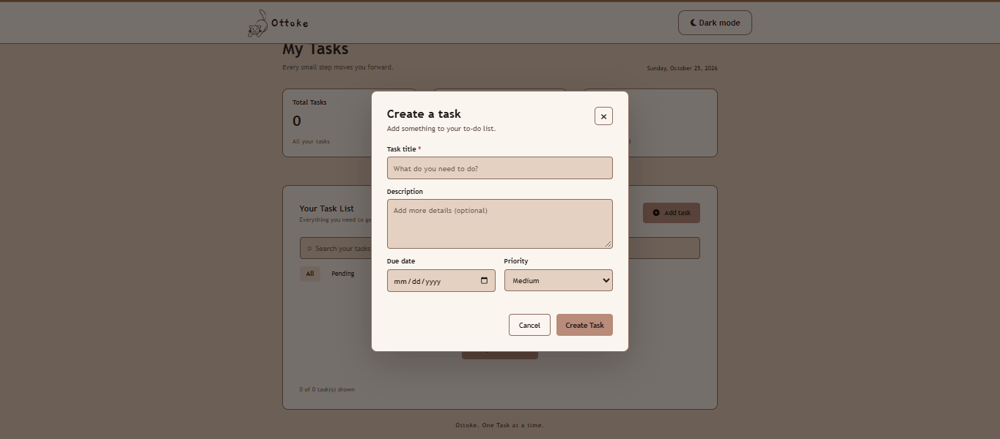
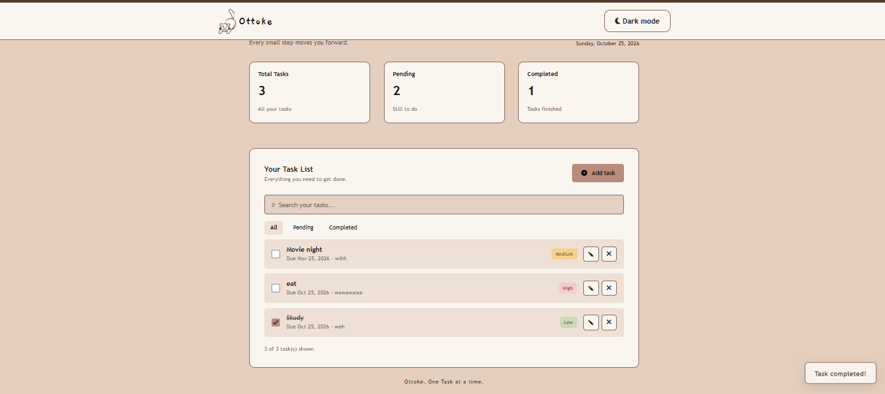
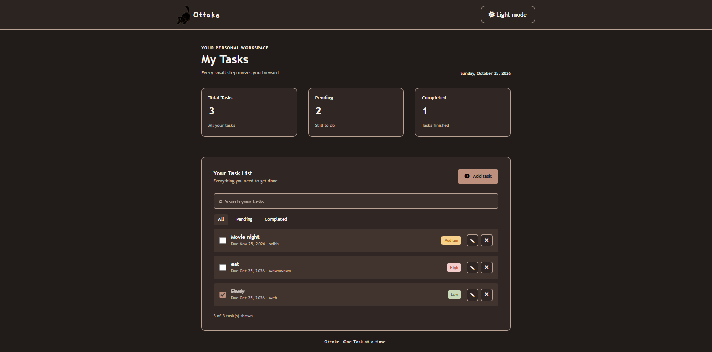

# Ottoke — Task Manager

Ottoke is a simple task management web application built as a hands-on project to practice frontend development, backend development, REST APIs, and database integration.

It allows users to organize their tasks through a clean interface while learning how frontend applications communicate with a backend API and persist data in MongoDB.

## Features

- **Create tasks** — Add new tasks with a title, description, due date, and priority.
- **View tasks** — Retrieve and display saved tasks from the database.
- **Edit tasks** — Update existing task information.
- **Complete tasks** — Mark tasks as completed.
- **Delete tasks** — Remove tasks you no longer need.
- **Task priorities** — Organize tasks by priority.
- **Theme toggle** — Switch the interface theme.
- **Persistent storage** — Store task data in MongoDB through a backend API.

## Tech Stack

**Frontend**
- HTML5
- CSS3
- Vanilla JavaScript

**Backend**
- Node.js
- Express.js
- REST API

**Database**
- MongoDB
- Mongoose

## Getting Started

### Prerequisites

- Node.js and npm
- MongoDB installed and running locally, or a MongoDB Atlas connection
- Git

### 1. Clone the repository

```bash
git clone https://github.com/YOUR-USERNAME/ottoke-task-manager.git
cd ottoke-task-manager
```

Replace `YOUR-USERNAME` with your GitHub username.

### 2. Install dependencies

```bash
npm install
```

### 3. Configure environment variables

Create a `.env` file in the project root:

```env
PORT=3000
MONGODB_URI=mongodb://127.0.0.1:27017/ottoke
```

If you use MongoDB Atlas, replace the local MongoDB URI with your own connection string.

**Important:** Never commit your real `.env` file, database credentials, or passwords to GitHub.

### 4. Start the server

Use the development command configured in `package.json`:

```bash
npm run dev
```

### 5. Open the application

Open the frontend using your project's configured setup. If Express serves the frontend, visit the local URL printed by the server, commonly:

`http://localhost:3000`

Check the project's existing configuration if your frontend uses a separate development server.

## What I Learned

This project helped me practice:

- Building REST API endpoints with Express.js.
- Implementing CRUD operations.
- Connecting a frontend to a backend using JavaScript `fetch()`.
- Sending and receiving JSON data.
- Using MongoDB and Mongoose to store task information.
- Handling API responses and errors.
- Updating the user interface after database operations.
- Managing environment variables and backend configuration.

## Project Goal

Ottoke is a learning project focused on understanding how frontend interfaces, backend APIs, and databases work together in a full-stack web application.

## 📌 Project Status

Learning project — core task CRUD functionality and frontend API integration have been implemented. Further improvements may be added as I continue learning full-stack development.

##  Screenshots

### Dashboard


### Add a Task


### Completed Task


### Dark Mode
